# index.html 說明文件

## 概述

這是手機練習網站的主要 HTML 文件，提供靜態單頁應用程式的結構框架。所有內容都在一個頁面中，透過 JavaScript 動態切換顯示。

## 頁面架構

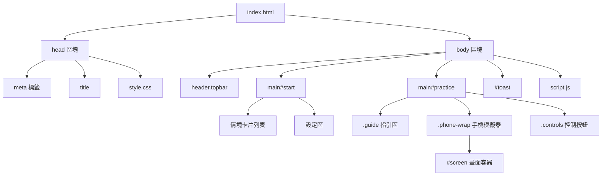

## DOM 結構

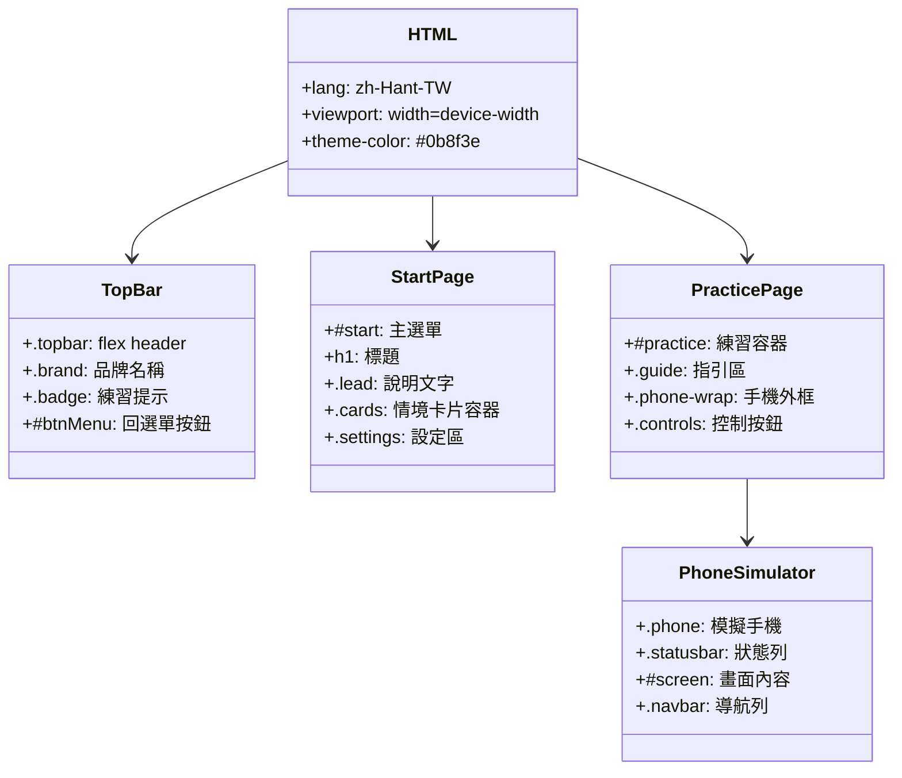

## 頁面流程

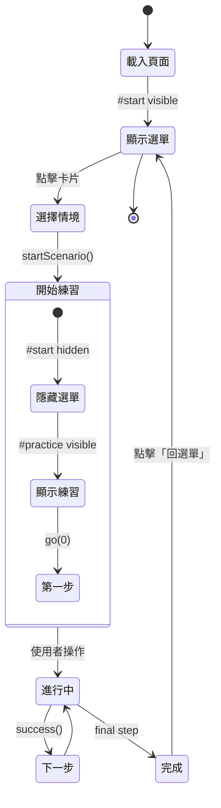

## 情境卡片結構

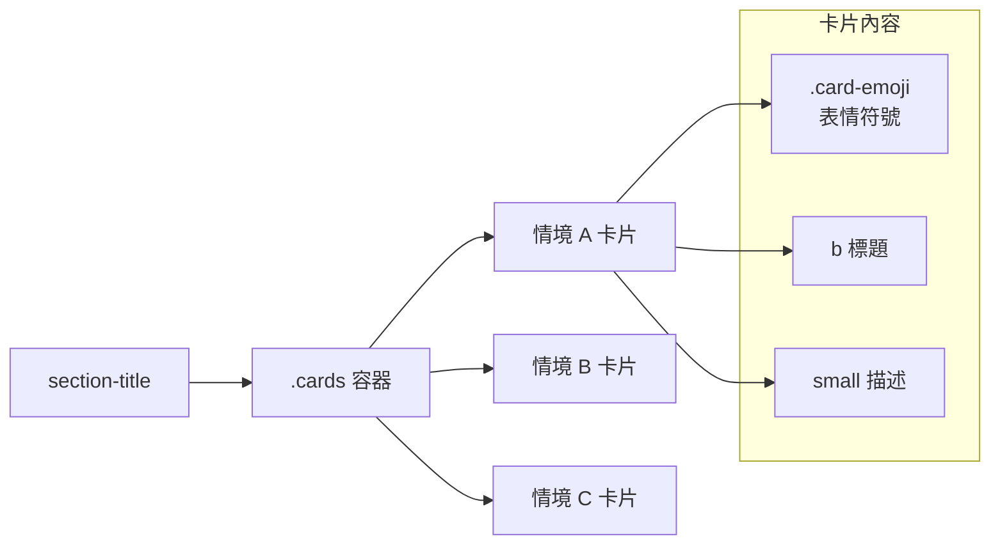

### 情境卡片範例

```html
<button class="card" data-scn="F">
  <span class="card-emoji" aria-hidden="true">✍️</span>
  <span class="card-txt">
    <b>在群組接龍留名字</b>
    <small>團購接龍時，複製最新訊息加上自己的名字</small>
  </span>
</button>
```

## 情境分組

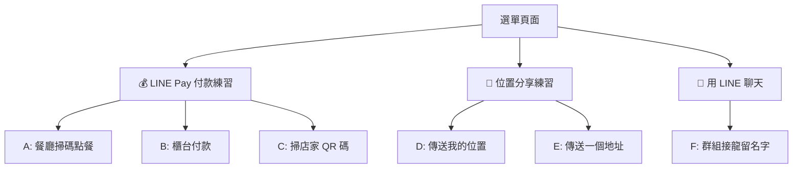

## 設定區組件

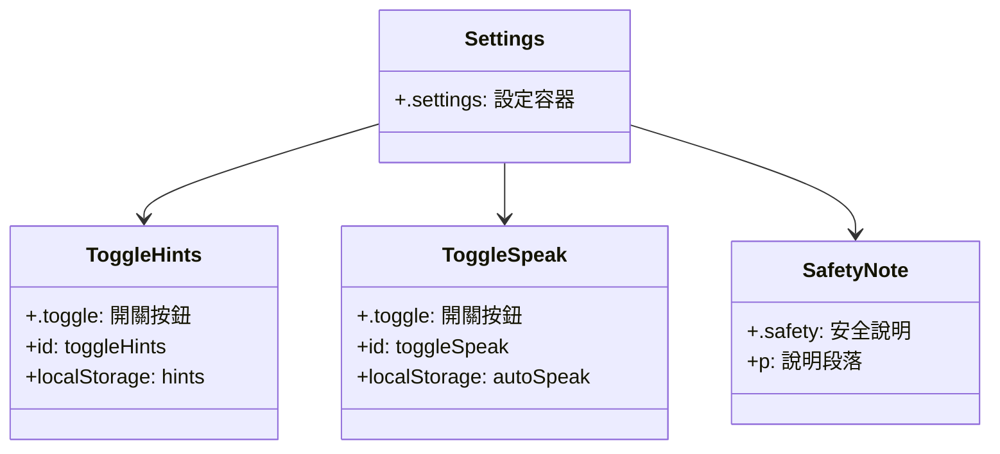

### 設定區 HTML

```html
<div class="settings">
  <button class="toggle" id="toggleHints">
    <span>💡 提示（會發亮）</span>
    <span class="on-off">開啟中</span>
  </button>
  <button class="toggle" id="toggleSpeak">
    <span>🔊 自動唸給我聽</span>
    <span class="on-off">關閉</span>
  </button>
</div>
<div class="safety">
  <p><b>安全</b>：練習用模擬畫面...</p>
</div>
```

## 練習頁面結構

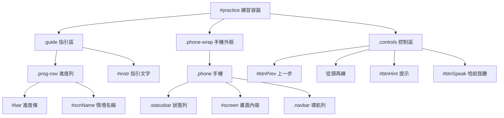

## 手機模擬器元素

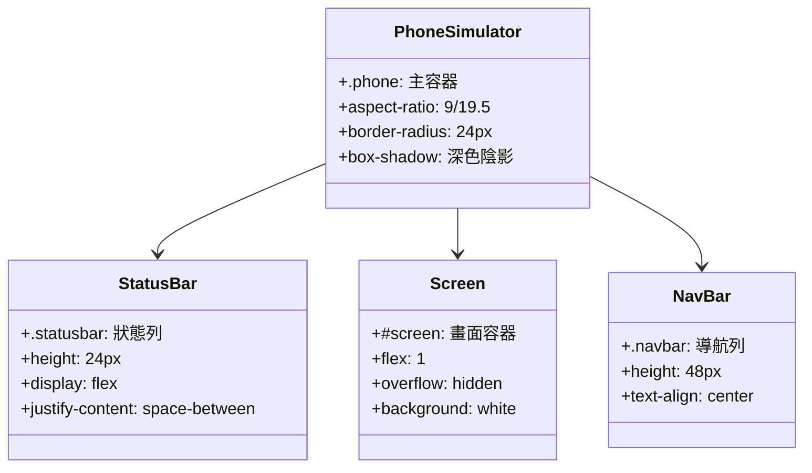

### 狀態列 HTML

```html
<div class="statusbar">
  <div class="status-left">
    <span class="status-icon">📶</span>
    <span class="status-icon">📱</span>
  </div>
  <div class="status-time">10:30</div>
  <div class="status-right">
    <span class="status-icon">🔋</span>
  </div>
</div>
```

## 控制按鈕

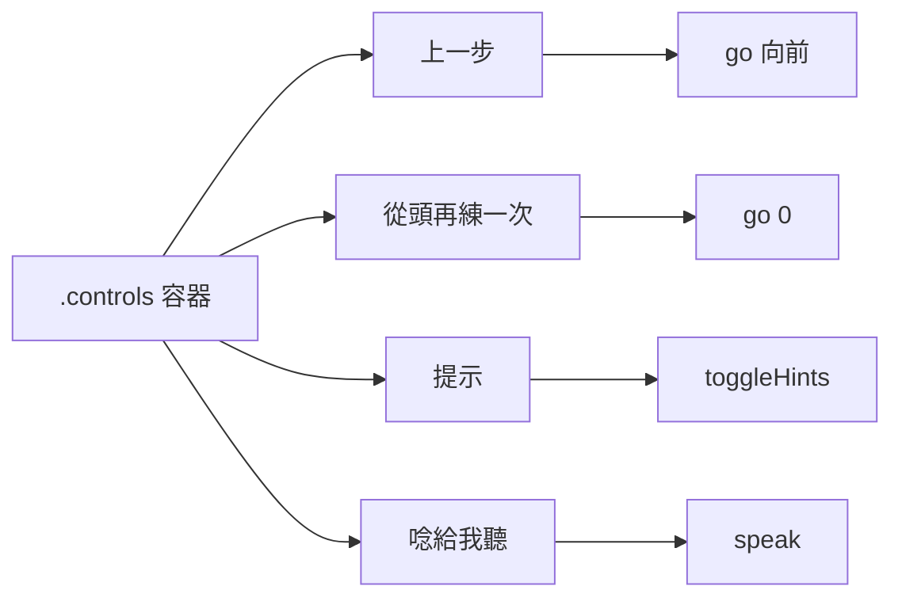

### 控制按鈕 HTML

```html
<div class="controls">
  <button id="btnPrev">上一步</button>
  <button id="btnReset">從頭<br>再練一次</button>
  <button id="btnHint">💡<br>提示</button>
  <button id="btnSpeak">🔊<br>唸給我聽</button>
</div>
```

## 提示框系統

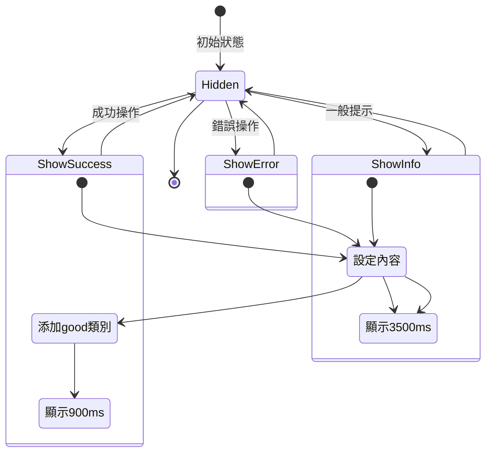

### 提示框 HTML

```html
<div id="toast" class="toast" hidden></div>
```

提示框透過 JavaScript 動態設定內容和樣式：

```javascript
toast('👍 很好！', true);  // 成功 - 綠色 900ms
toast('😊 再試一次');      // 錯誤 - 深灰 3500ms
```

## 深連結支援

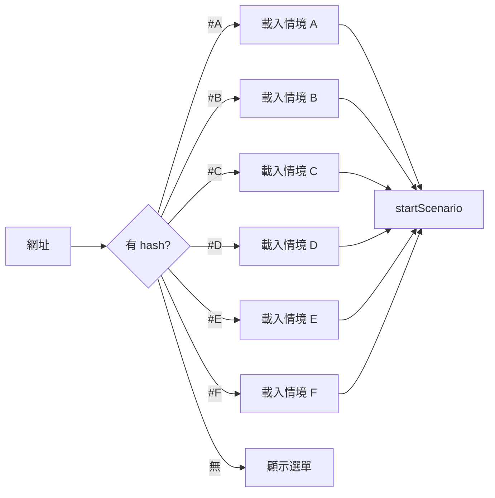

支援的深連結：
- `#A` - 餐廳掃碼點餐
- `#B` - 櫃台付款
- `#C` - 掃店家 QR 碼
- `#D` - 傳送我的位置
- `#E` - 傳送一個地址
- `#F` - 群組接龍留名字

## Meta 標籤

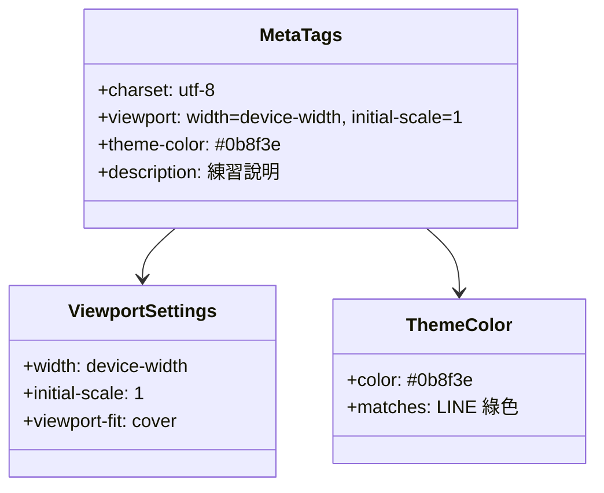

### Meta 標籤 HTML

```html
<meta charset="utf-8">
<meta name="viewport" content="width=device-width, initial-scale=1, viewport-fit=cover">
<meta name="theme-color" content="#0b8f3e">
<meta name="description" content="給長輩的手機練習...">
```

## 資料屬性系統

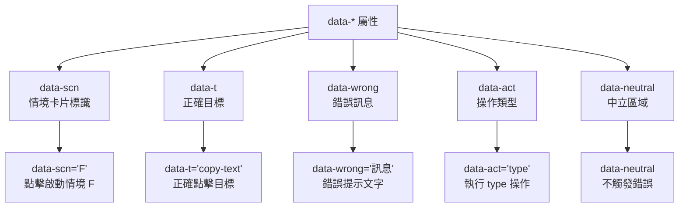

### 資料屬性範例

```html
<!-- 情境卡片 -->
<button class="card" data-scn="F">...</button>

<!-- 正確目標 -->
<button data-t="copy-text">複製</button>

<!-- 錯誤提示 -->
<button data-wrong="這是轉傳。我們要按「複製」。">轉傳</button>

<!-- 操作按鈕 -->
<button data-act="type" data-v="小蓉">小蓉</button>

<!-- 中立區域（不觸發錯誤） -->
<div class="keyboard" data-neutral>...</div>
```

## 無障礙屬性

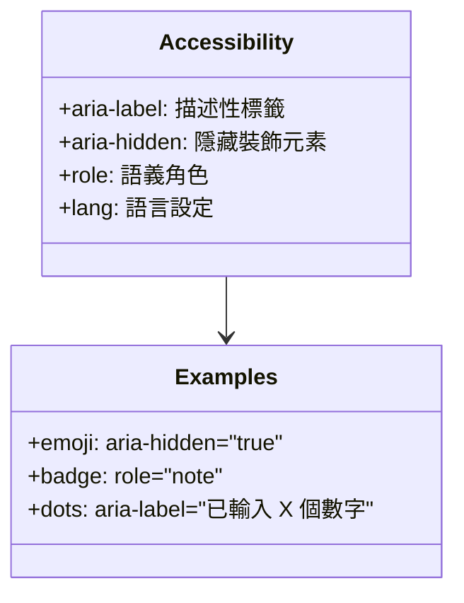

### 無障礙範例

```html
<!-- 表情符號不需朗讀 -->
<span class="card-emoji" aria-hidden="true">✍️</span>

<!-- 提示訊息 -->
<div class="badge" role="note">練習用模擬畫面</div>

<!-- 密碼點點 -->
<div class="dots" aria-label="已輸入 3 個數字">...</div>
```

## 頁面載入流程

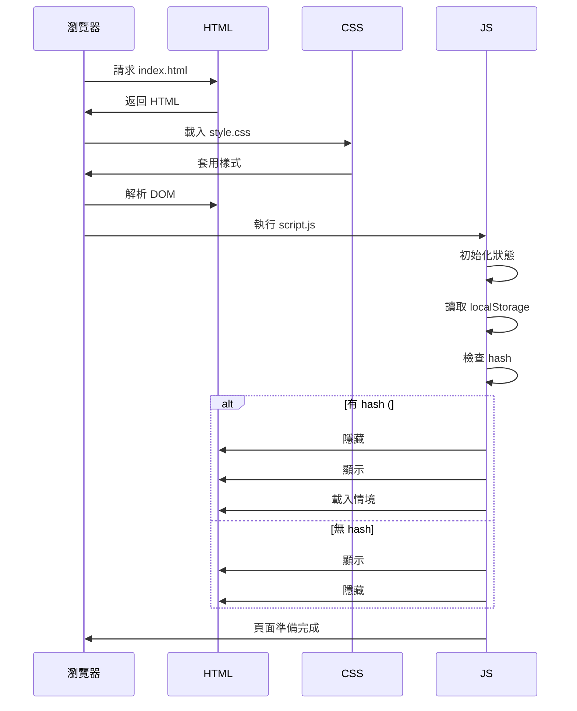

## 使用者互動流程

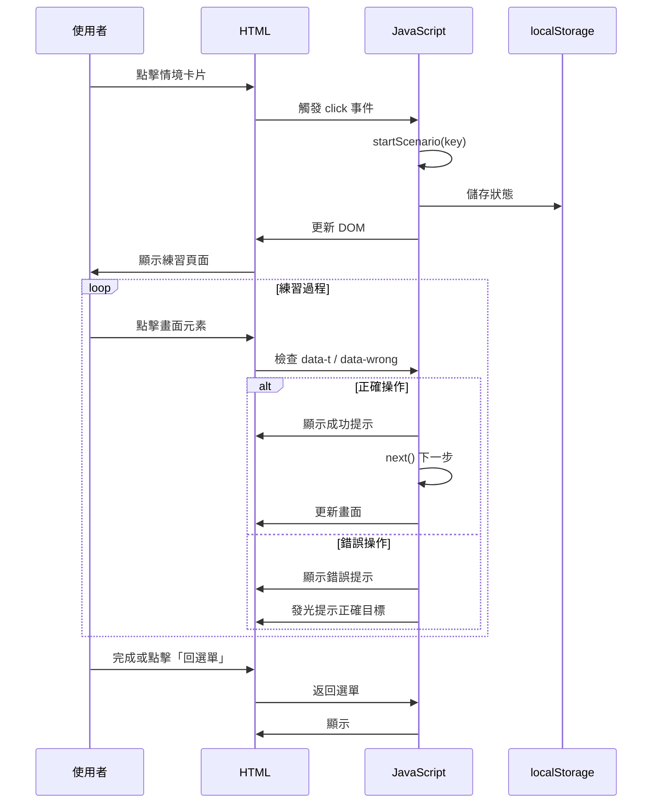

## HTML 元素 ID 參考

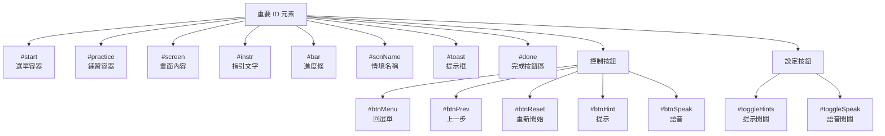

## 維護指南

### 新增情境步驟

1. **在 HTML 中新增卡片**

```html
<button class="card" data-scn="G">
  <span class="card-emoji" aria-hidden="true">🆕</span>
  <span class="card-txt">
    <b>新情境名稱</b>
    <small>簡短描述</small>
  </span>
</button>
```

2. **在 script.js 定義情境**

```javascript
SCENARIOS.G = {
  name: '新情境名稱',
  steps: [...]
};
```

3. **更新 README.md**

### 修改頁面標題或描述

修改 `<head>` 區塊：

```html
<title>你的標題</title>
<meta name="description" content="你的描述">
```

### 調整手機模擬器尺寸

修改 `.phone` 的 CSS：

```css
.phone {
  aspect-ratio: 9/19.5;  /* 調整這個比例 */
  max-height: 680px;     /* 調整最大高度 */
}
```

## 靜態部署

此 HTML 檔案為靜態單頁應用程式，可直接部署到：

- GitHub Pages
- Netlify
- Vercel
- 任何靜態主機

部署需求：
- 僅需 3 個檔案：`index.html`、`style.css`、`script.js`
- 無需 build 步驟
- 無需伺服器端處理
- 完全離線可用

## 總結

index.html 的設計理念：

1. **簡潔結構**：最小化 DOM 元素
2. **語義化標籤**：正確使用 HTML5 標籤
3. **無障礙友善**：適當的 ARIA 屬性
4. **響應式設計**：搭配 CSS 媒體查詢
5. **深連結支援**：方便直接進入特定練習
6. **離線友善**：無外部依賴
