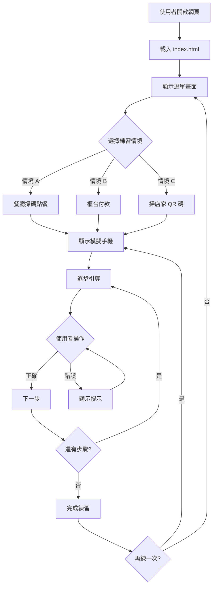
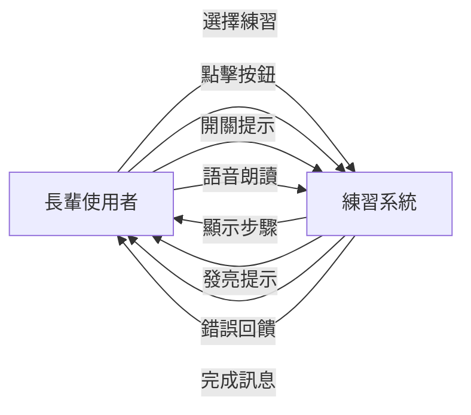
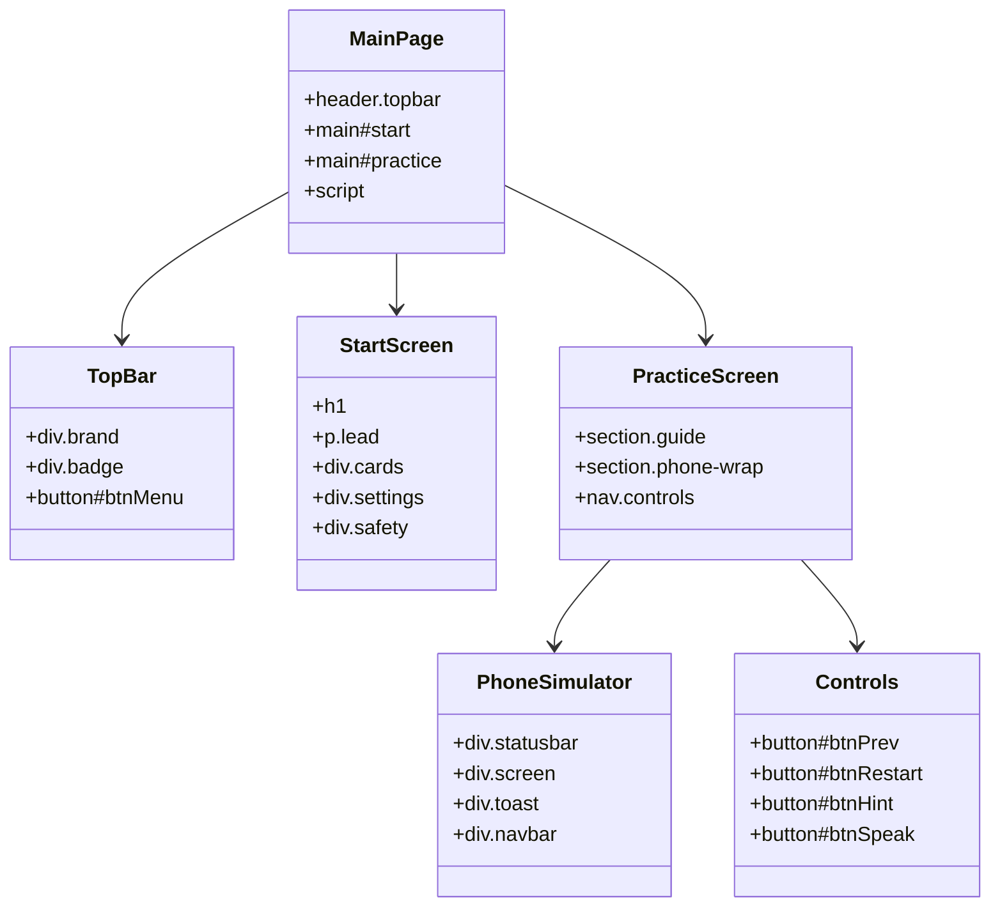
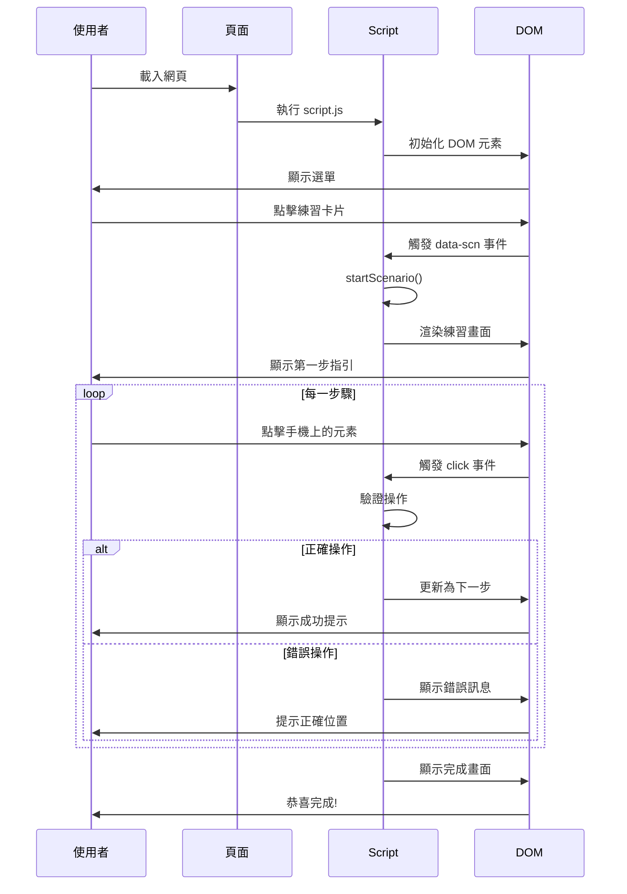
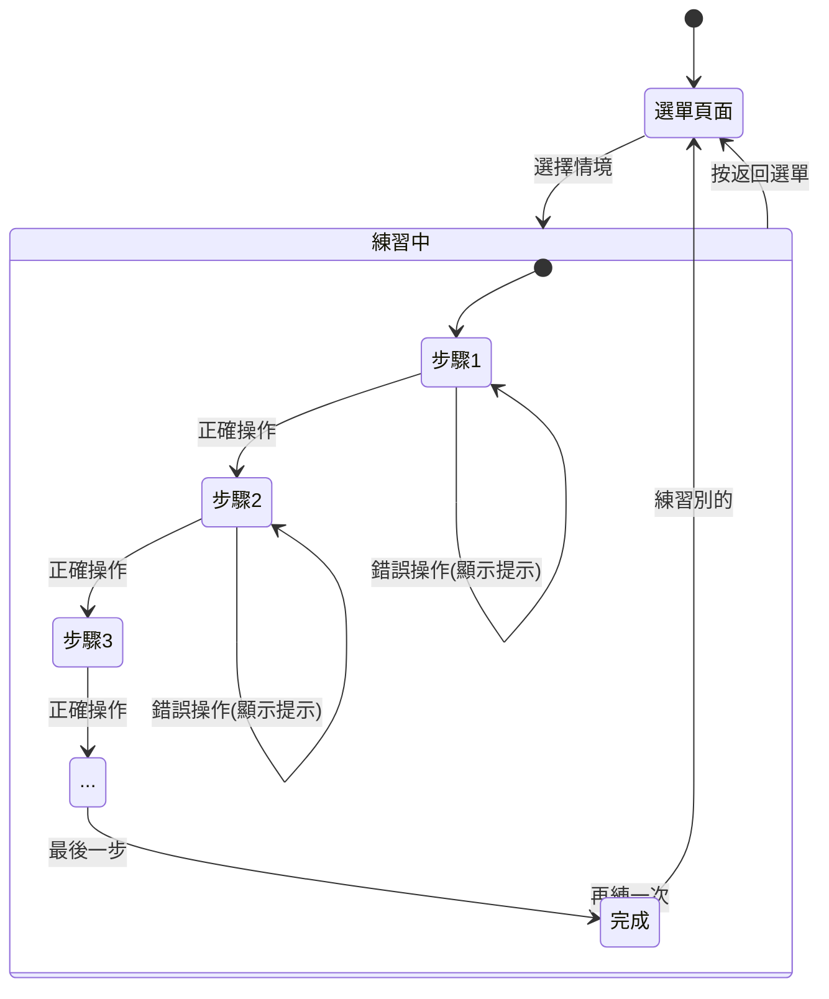

# index.html - 網頁結構文件

## 檔案說明

此檔案是 LINE Pay 練習網站的主要 HTML 結構文件。

## 流程圖

## 使用案例圖

## 組件結構圖

## 資料流程圖

## 頁面狀態圖

## HTML 結構特點

### 語義化標籤
- 使用 `<header>`, `<main>`, `<section>`, `<nav>` 等語義化標籤
- 提升可訪問性和 SEO

### 無障礙設計
- 適當使用 `aria-*` 屬性
- 提供 `role` 屬性
- 支援鍵盤導航

### 響應式設計
- `viewport` meta 設定
- `viewport-fit=cover` 支援全屏設備
- CSS 媒體查詢配合

### 效能優化
- 外部 CSS 和 JS 檔案
- 最小化內聯樣式
- 結構清晰易於維護
