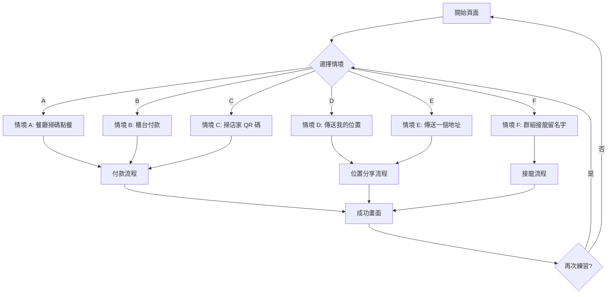
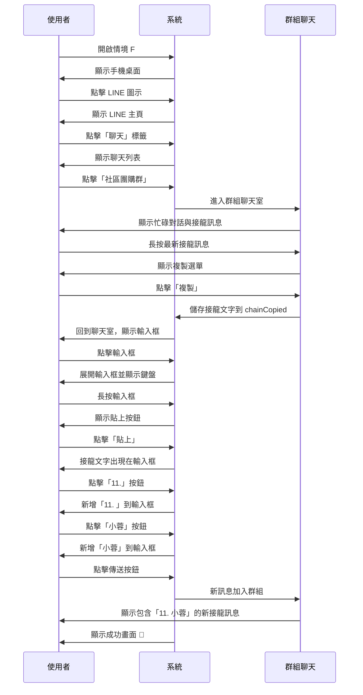
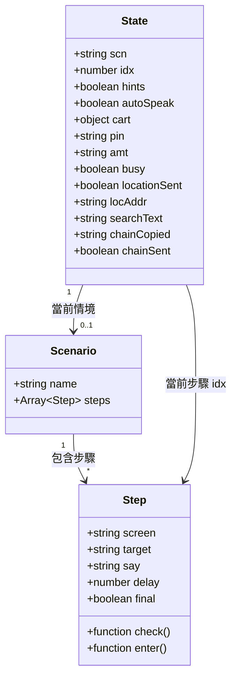
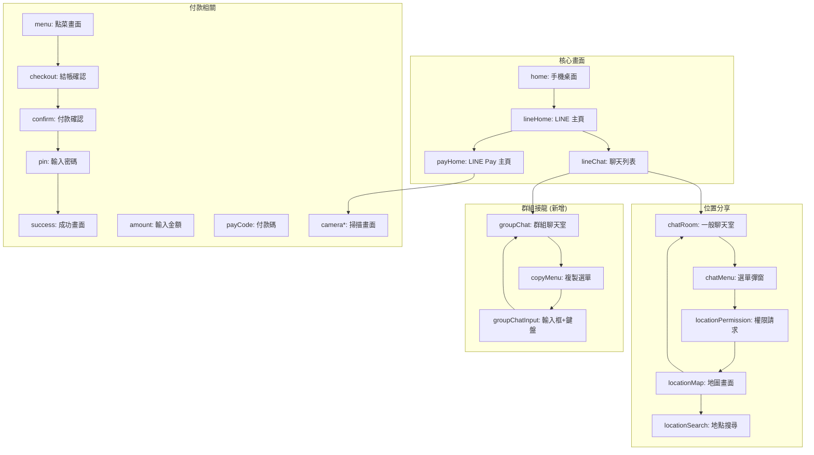
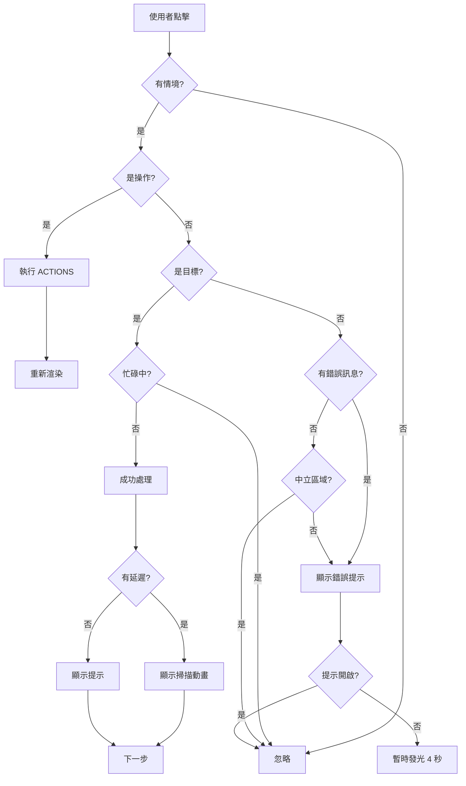
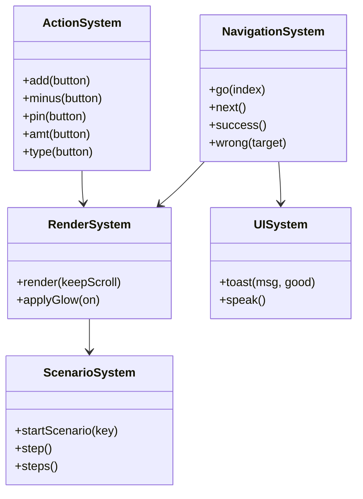
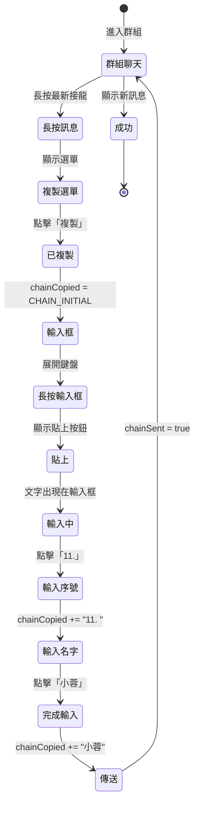
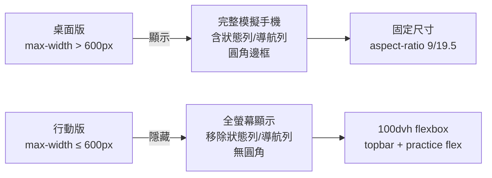
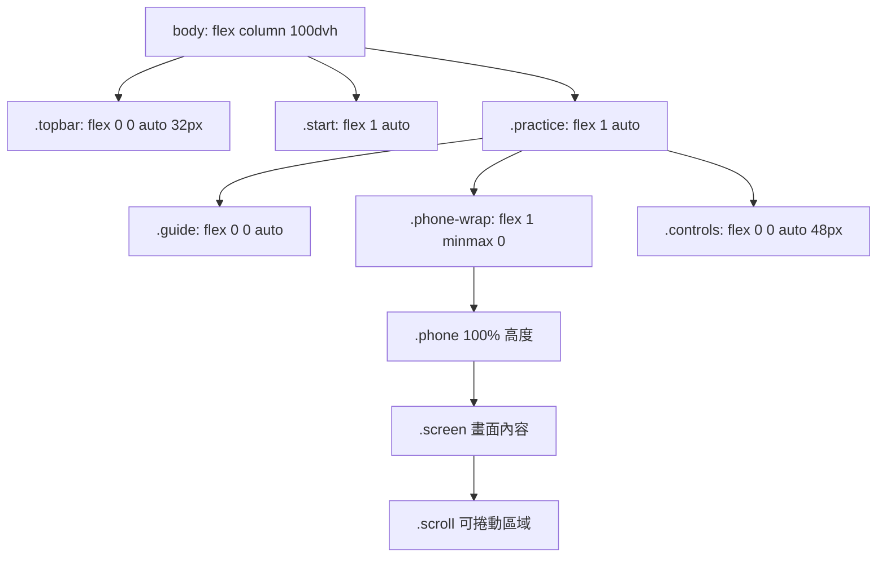

# script.js 說明文件

## 概述

這是手機練習網站的核心邏輯檔案，負責處理所有使用者互動、狀態管理和畫面渲染。

## 情境流程圖



## 情境 F 詳細流程



## 狀態管理



## 畫面組件架構



## 事件處理流程



## 資料結構

### 配置常數

```javascript
// LINE Pay 付款情境
const MENU = [餐點列表]
const REST = '幸福小館'
const SHOP_B = '好味便當'
const SHOP_C = '巷口豆漿店'

// 接龍情境配置（可修改）
const CHAIN_USER_NAME = '小蓉'
const CHAIN_INITIAL = '【團購】臺南愛文芒果 要的請接龍\n1. 美玲\n2. 阿芳\n...'
```

### 情境定義

每個情境包含：
- `name`: 情境名稱
- `steps`: 步驟陣列

每個步驟包含：
- `screen`: 要顯示的畫面名稱
- `target`: 正確的點擊目標 (data-t 屬性)
- `say`: 指引文字（可以是函數）
- `check`: 檢查函數（可選）
- `enter`: 進入步驟時執行（可選）
- `delay`: 延遲時間（可選）
- `final`: 是否為最後一步（可選）

## 核心函數



## 群組接龍特殊邏輯

### 複製貼上機制



## 響應式設計

### 行動端適配



### 布局結構



## 修改指南

### 如何新增情境

1. 在 `SCENARIOS` 物件中新增情境定義
2. 定義 `steps` 陣列，每步包含 `screen`、`target`、`say`
3. 在 `SCREENS` 物件中實作需要的畫面函數
4. 在 `index.html` 中新增情境卡片
5. 更新 `README.md` 文件

### 如何修改使用者名稱

只需修改一個常數：

```javascript
const CHAIN_USER_NAME = '您的名字';
```

### 如何調整接龍初始內容

修改 `CHAIN_INITIAL` 常數：

```javascript
const CHAIN_INITIAL = [
  '【團購】您的商品名稱',
  '1. 名字一',
  '2. 名字二',
  // ... 更多名字
].join('\n');
```

## 維護注意事項

1. **無捲軸保證**：確保所有步驟在 360×640、390×700、412×760、1280×800 視窗都能完整顯示
2. **提示機制**：所有可點擊元素都要有 `data-t`（正確）或 `data-wrong`（錯誤）屬性
3. **語音朗讀**：`say` 文字要避免 HTML 標籤，使用 `plain()` 函數清理
4. **狀態重置**：新增情境時記得在 `startScenario()` 中重置相關狀態
5. **行動端優先**：先確保行動端正確，再考慮桌面版顯示
