# script.js - 腳本邏輯文件

## 檔案說明

此檔案包含 LINE Pay 練習網站的所有互動邏輯，包括步驟控制、事件處理、語音朗讀等功能。

## 系統架構圖

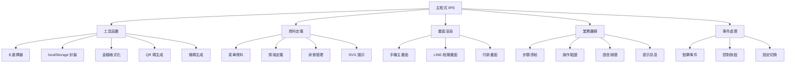

## 類別結構圖

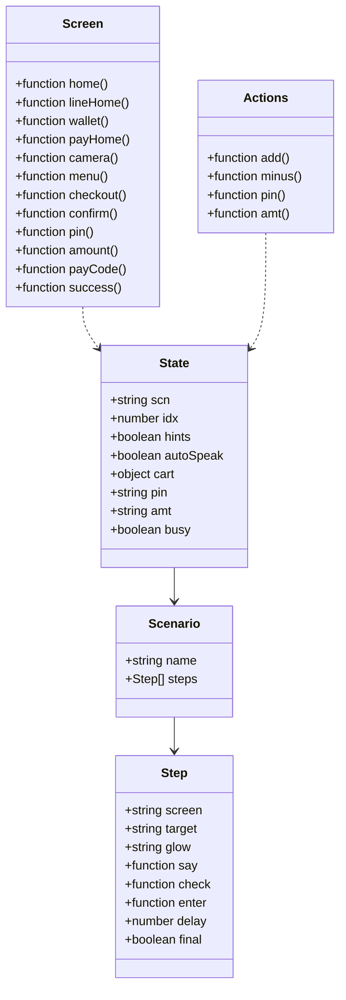

## 執行流程圖

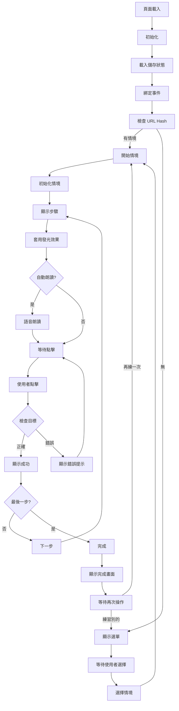

## 狀態管理圖

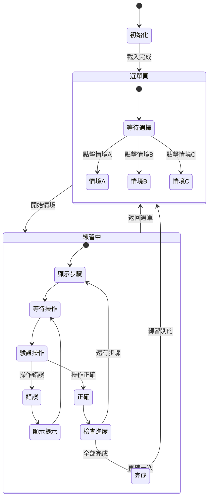

## 事件處理流程

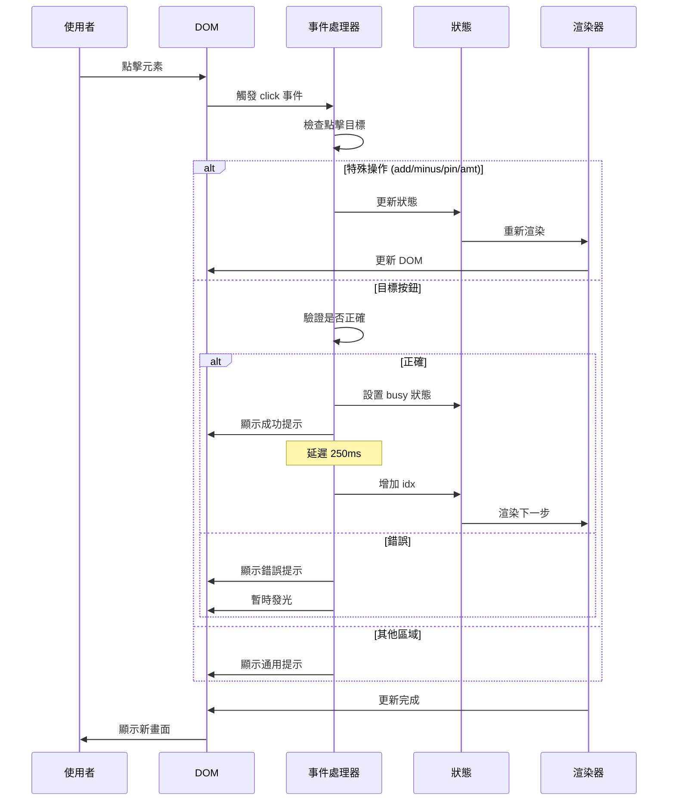

## 資料流向圖

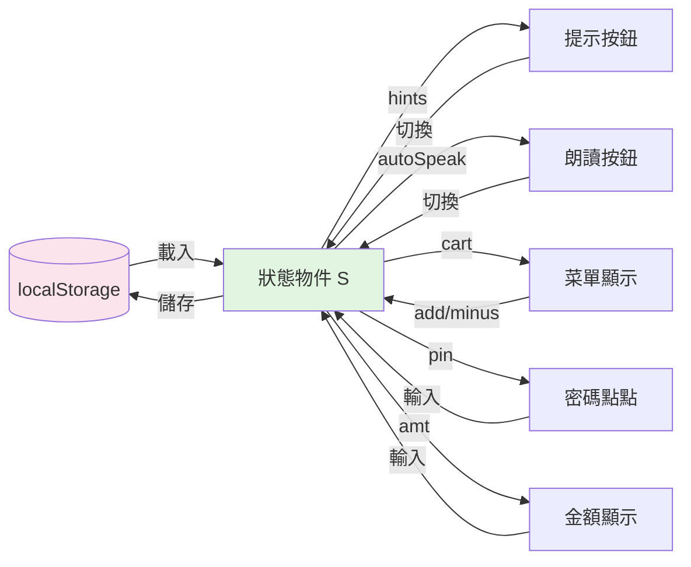

## 語音朗讀流程

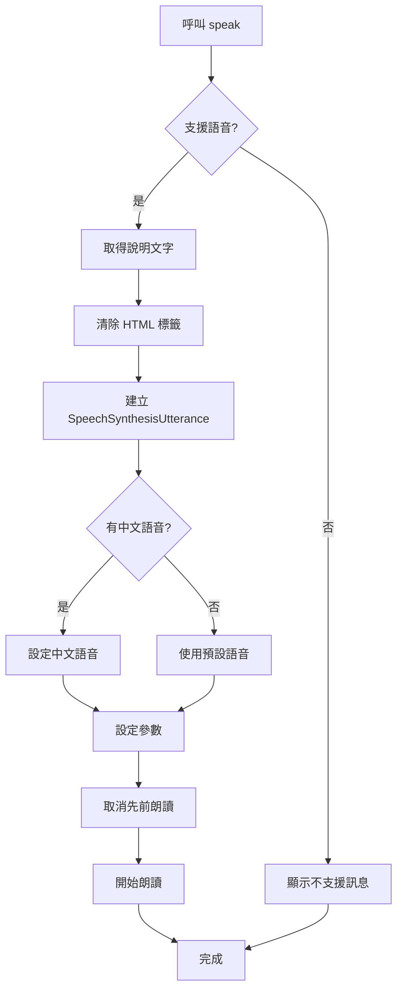

## QR 碼生成演算法

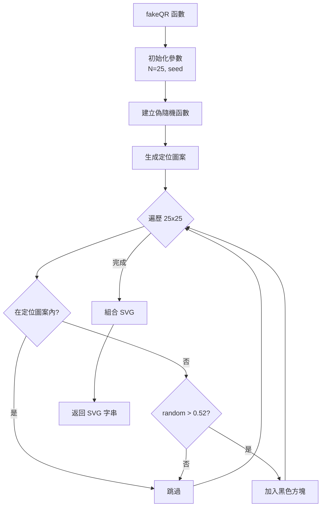

## 購物車邏輯

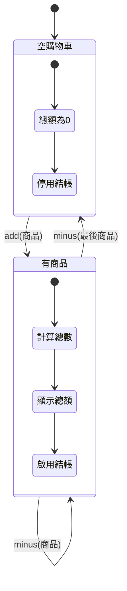

## PIN 碼輸入流程

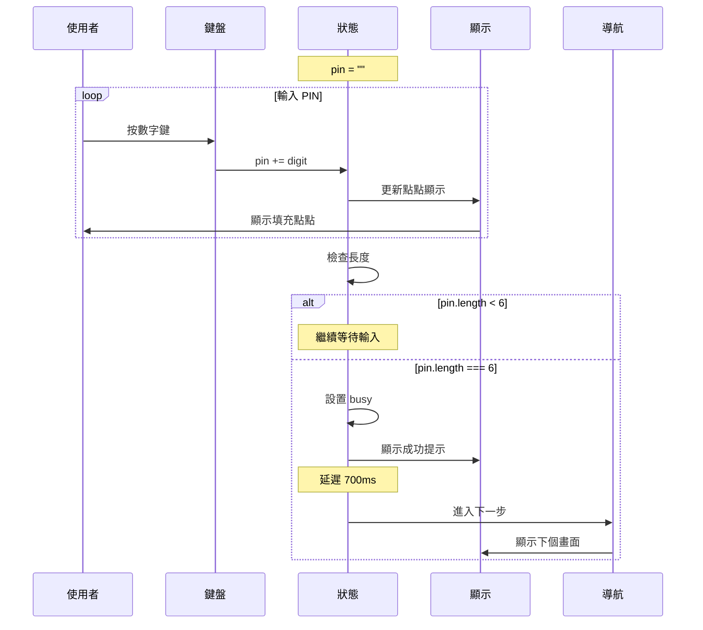

## 錯誤處理機制

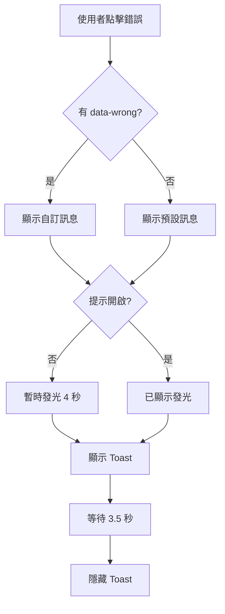

## 關鍵函數說明

### render()
渲染當前步驟，更新所有 UI 元素

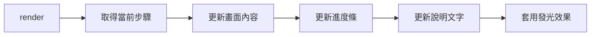

### go(index)
導航到指定步驟

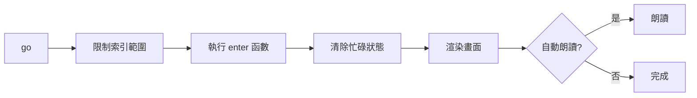

### success()
處理正確操作

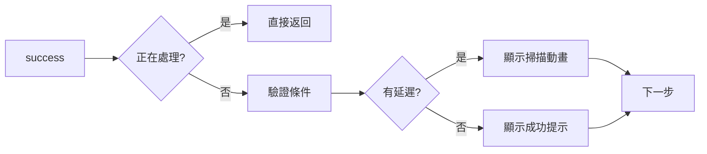

## 效能優化

- 使用事件委派 (Event Delegation)
- 最小化 DOM 操作
- 適當使用 debounce (localStorage)
- 避免記憶體洩漏 (取消語音)
