# style.css - 樣式表文件

## 檔案說明

此檔案定義了 LINE Pay 練習網站的所有視覺樣式，包含響應式設計和動畫效果。

## CSS 架構圖

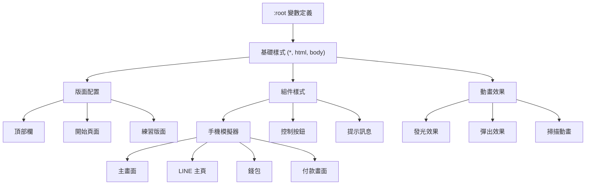

## CSS 變數系統

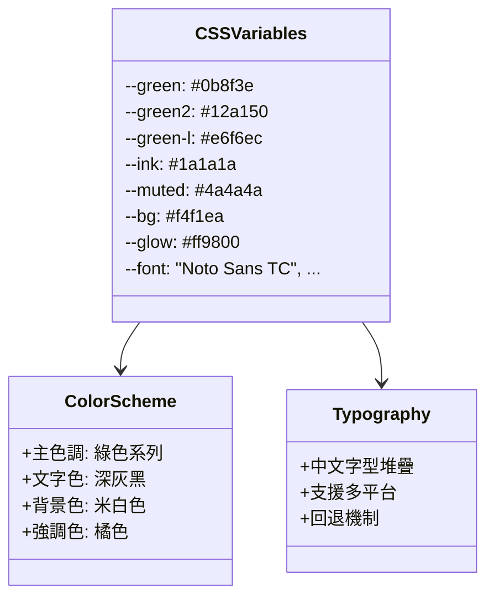

## 響應式設計流程

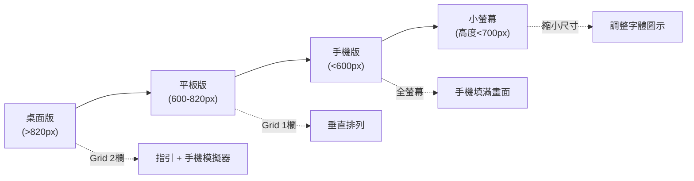

## 組件樣式圖

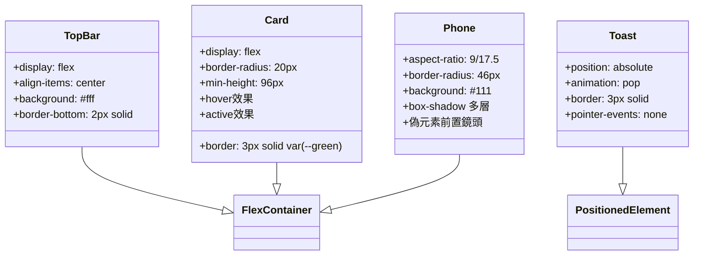

## 動畫時序圖

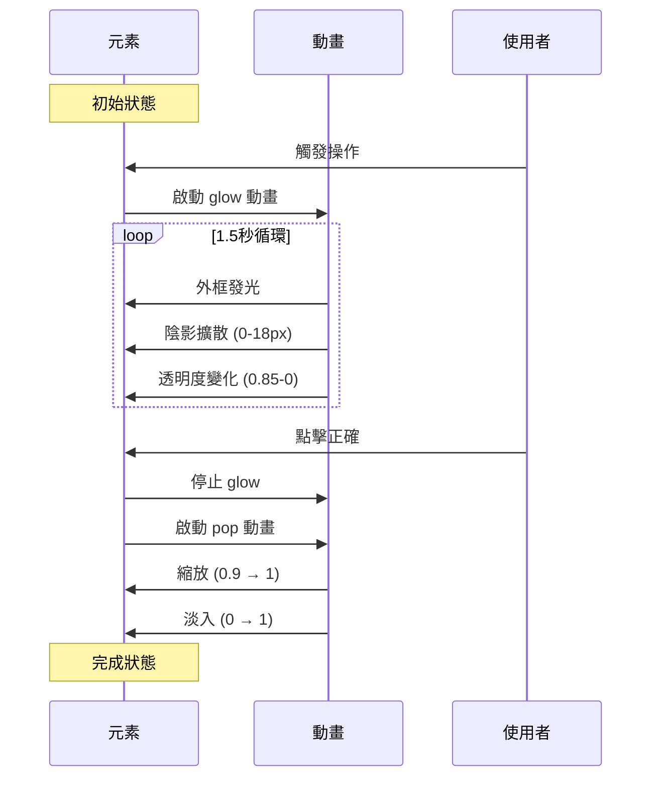

## 媒體查詢決策樹

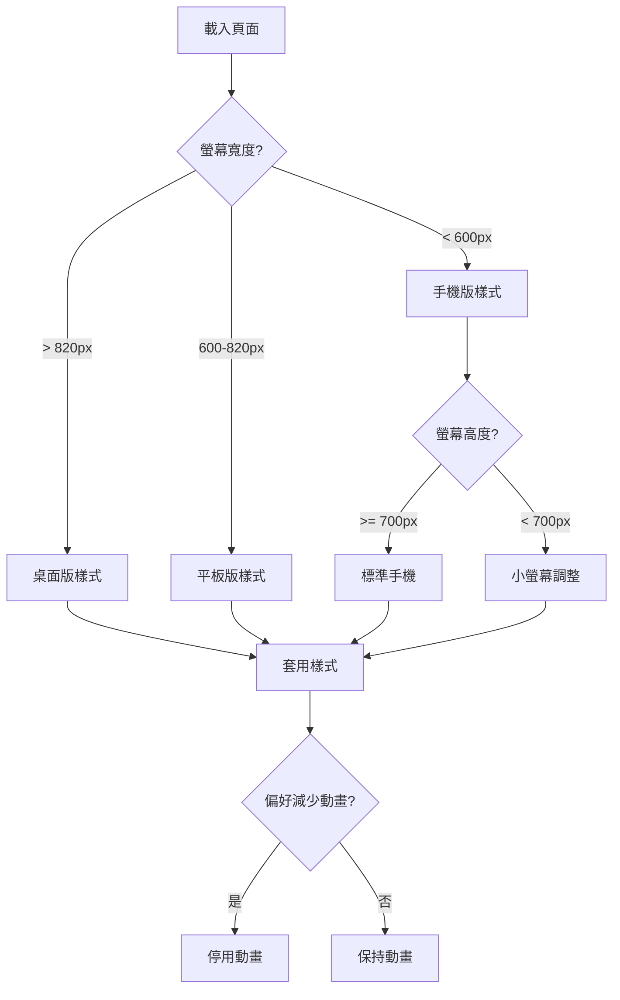

## 佈局系統

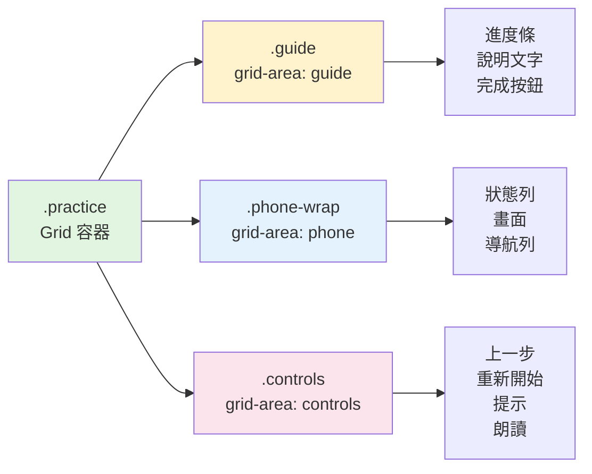

## 關鍵 CSS 技術

### 1. Grid 佈局
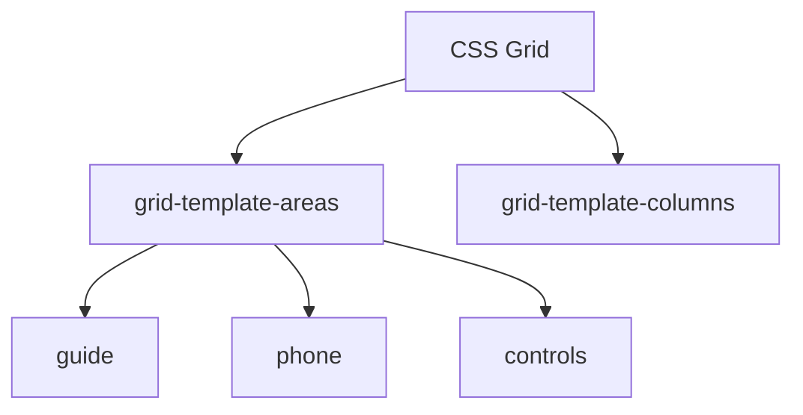

### 2. Flexbox 應用
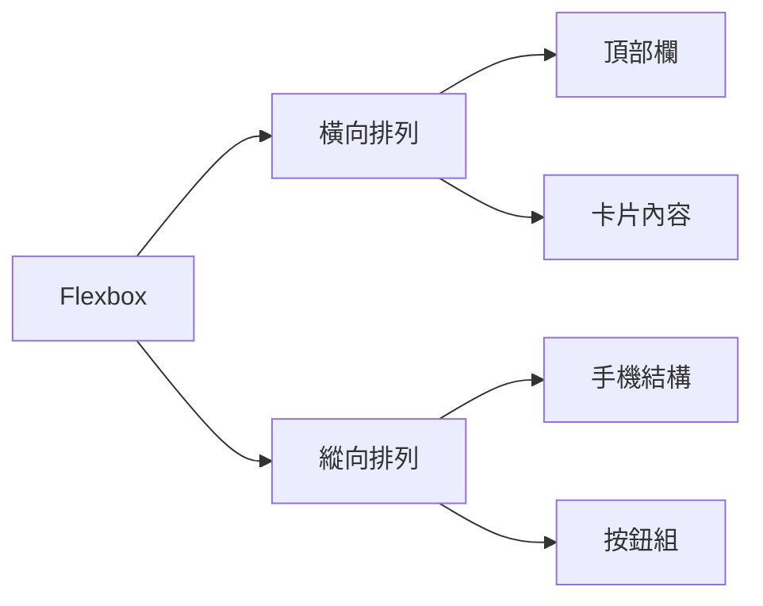

### 3. 動畫系統
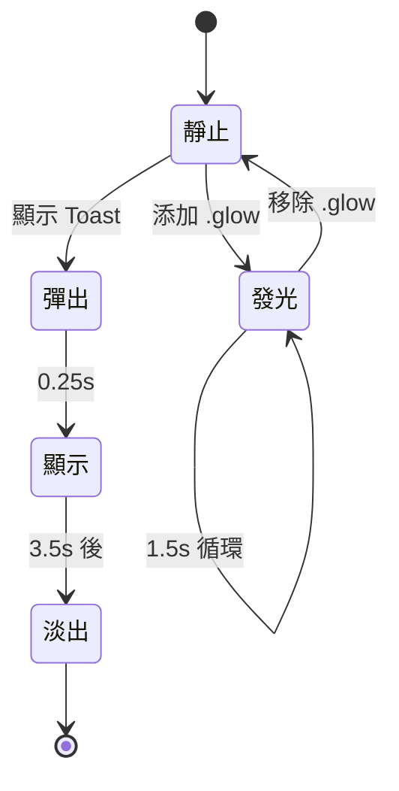

## 顏色使用指南

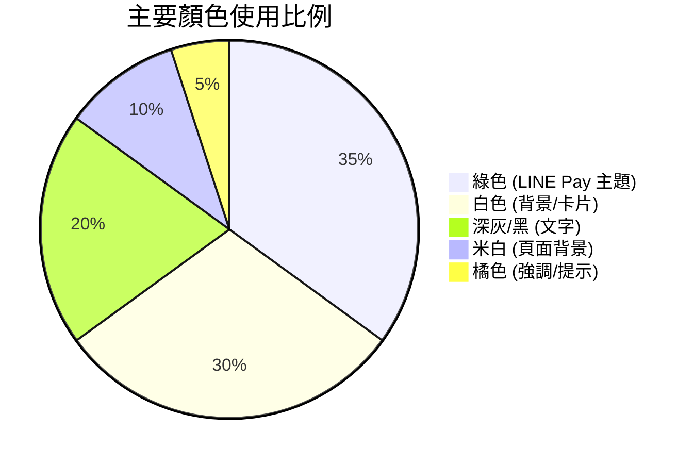

## 響應式斷點

| 斷點 | 說明 | 主要變化 |
|------|------|----------|
| > 820px | 桌面版 | 兩欄佈局，手機居中 |
| 600-820px | 平板版 | 單欄佈局，垂直排列 |
| < 600px | 手機版 | 手機填滿螢幕 |
| < 700px (高度) | 小螢幕 | 縮小圖示和按鈕 |

## 效能優化

- 使用 CSS 變數減少重複
- 適當使用 `will-change` (未使用過度)
- 簡化選擇器
- 避免過度巢狀
- 使用 `transform` 和 `opacity` 做動畫
