# style.css 說明文件

## 概述

這是手機練習網站的樣式表，負責所有視覺呈現和響應式布局。設計重點是確保在各種螢幕尺寸上都能完整顯示，不需要捲動頁面。

## 整體架構

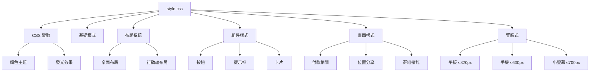

## CSS 變數定義

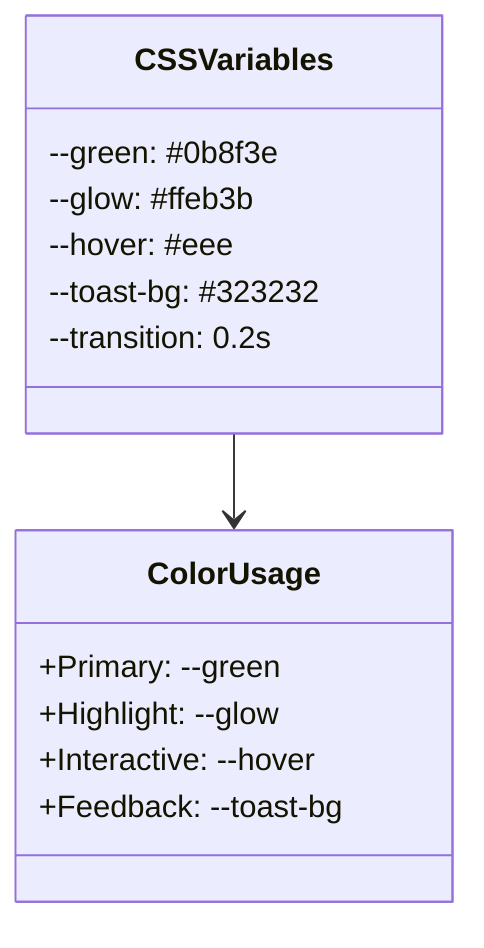

## 布局系統架構

### 桌面版布局

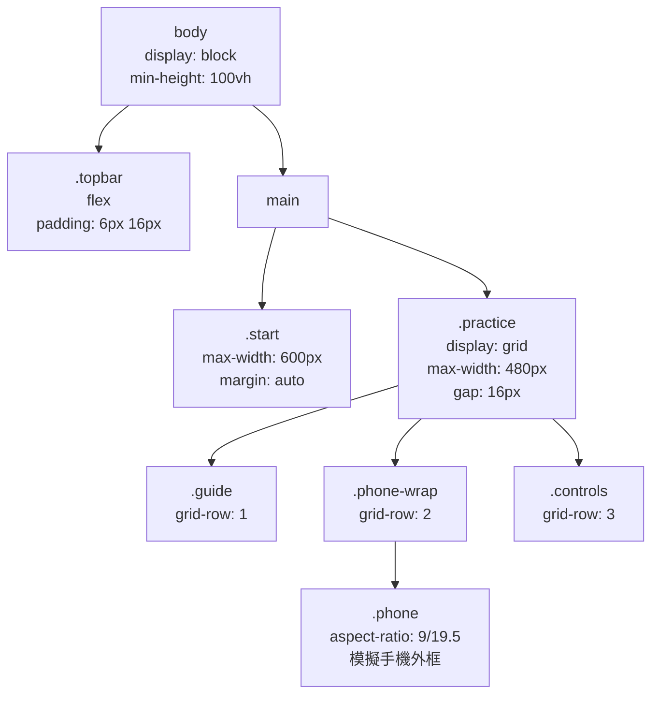

### 行動版布局（≤600px）

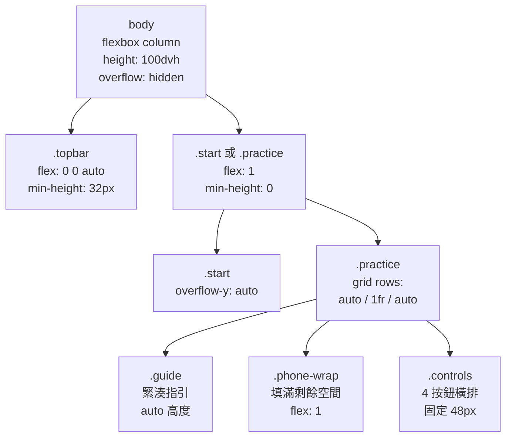

## 響應式斷點

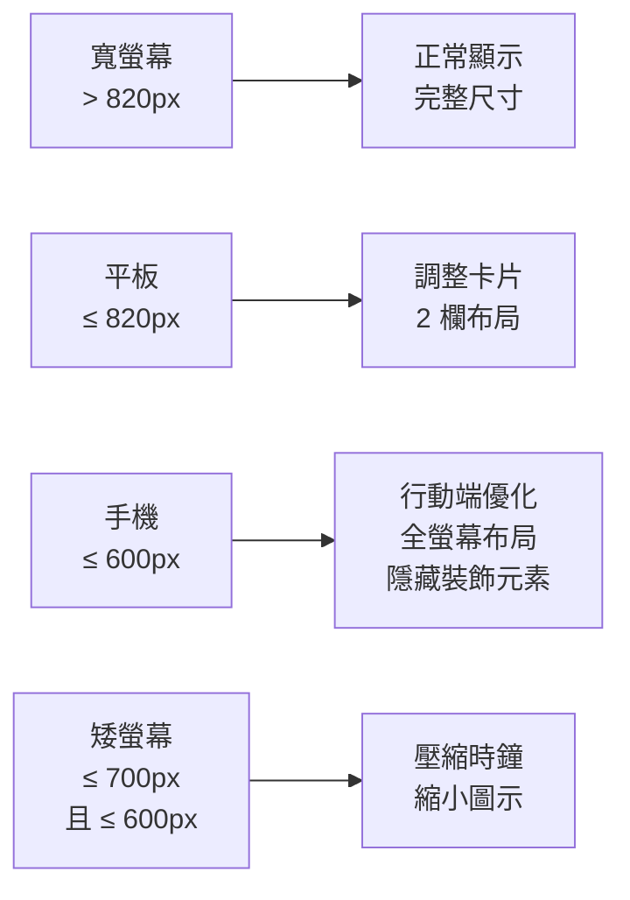

## 關鍵 CSS 類別

### 畫面容器

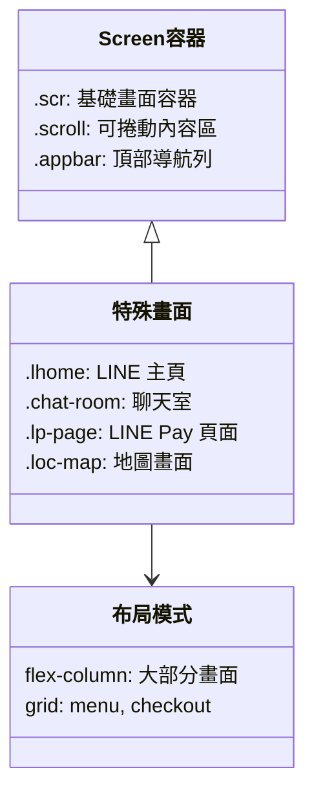

## 群組接龍相關樣式

### 聊天室組件

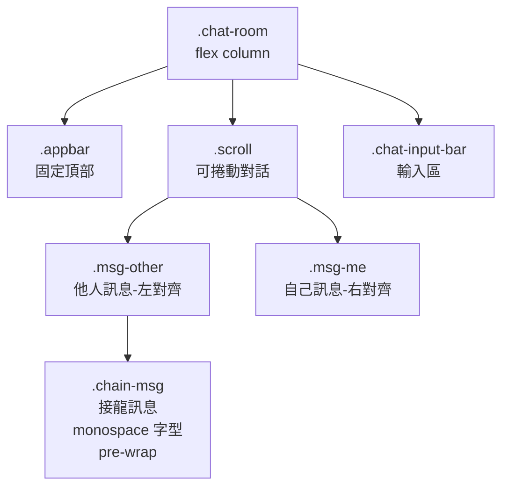

### 複製選單

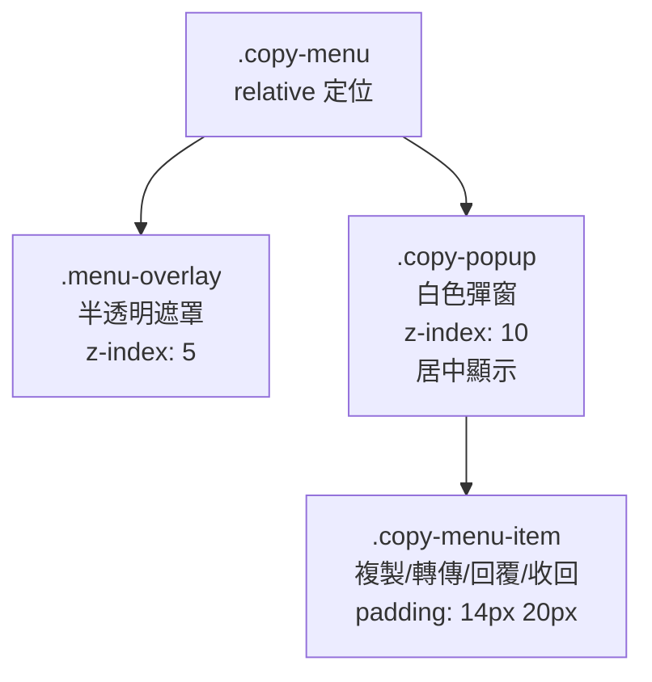

### 輸入框與鍵盤

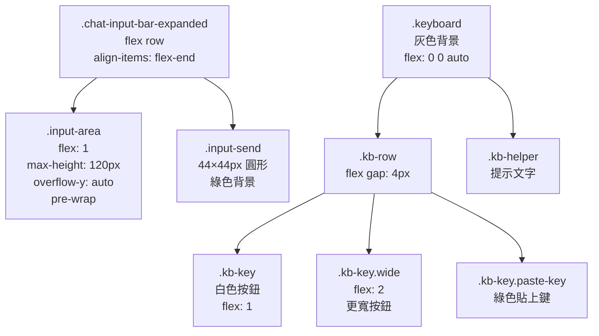

## 動畫效果

```mermaid
graph LR
    Pulse[@keyframes pulse<br/>發光脈動<br/>0% → 50% → 100%] --> Glow[發光效果<br/>box-shadow]
    
    Pop[@keyframes pop<br/>彈出效果<br/>scale 0.8 → 1.05 → 1] --> Toast[提示框出現]
    
    Bounce[@keyframes bounce<br/>彈跳效果<br/>translate Y 移動] --> Pin[地圖釘子]
    
    Scan[.scanning<br/>掃描動畫<br/>淡入 + 掃描線] --> Delay[延遲操作]
```

## 發光提示機制

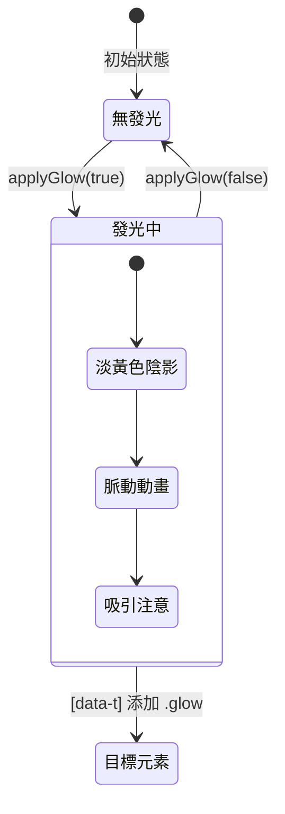

### 發光樣式定義

```css
[data-t].glow {
  animation: pulse 1.5s ease-in-out infinite;
  position: relative;
  z-index: 5;
}

@keyframes pulse {
  0%, 100% {
    box-shadow: 0 0 0 0 var(--glow), 
                0 0 20px 5px #ffeb3b88;
  }
  50% {
    box-shadow: 0 0 0 8px #ffeb3b00, 
                0 0 30px 10px #ffeb3baa;
  }
}
```

## 行動端優化策略

### 尺寸調整原則

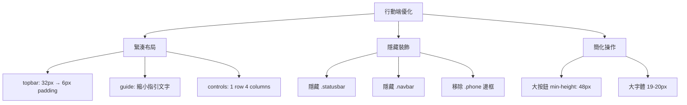

### 無捲軸保證

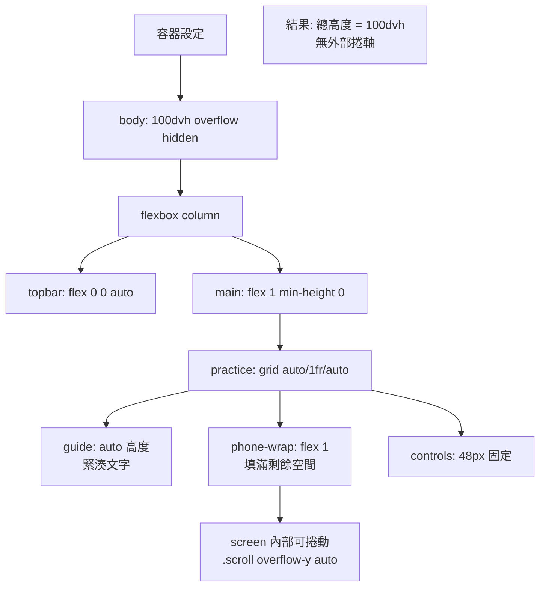

## 特殊元件樣式

### 聊天泡泡

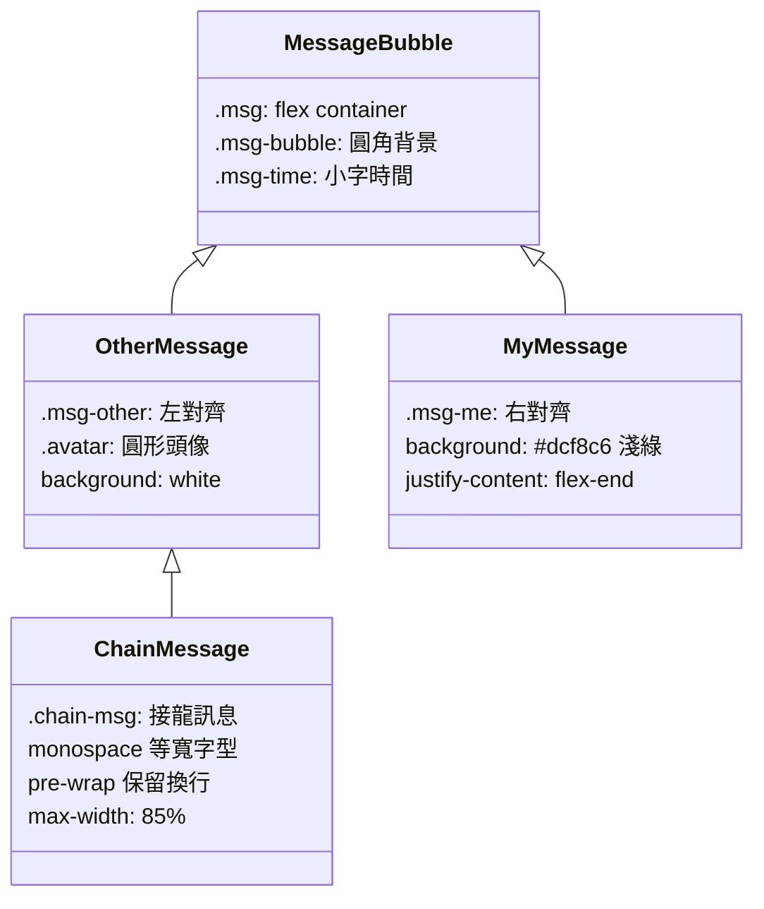

### 地圖畫面

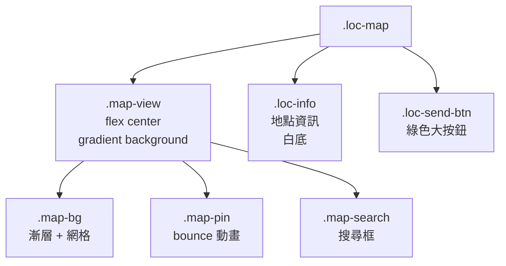

### 鍵盤樣式

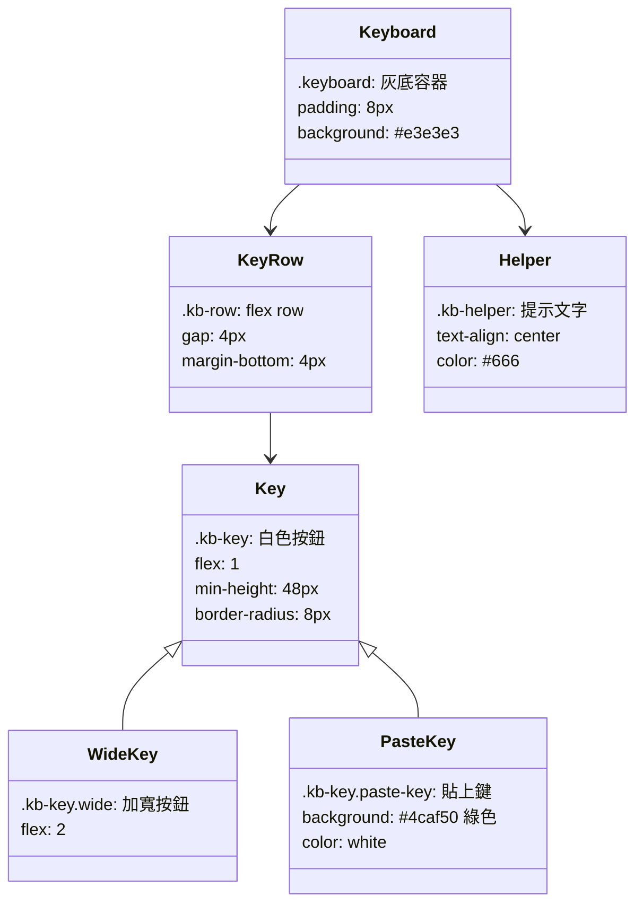

## 提示框系統

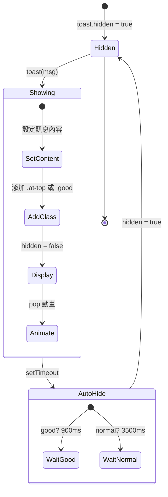

### 提示框樣式

```css
.toast {
  position: fixed;
  bottom: 100px;
  left: 50%;
  transform: translateX(-50%);
  background: var(--toast-bg);
  color: white;
  padding: 12px 20px;
  border-radius: 12px;
  font-size: 20px;
  z-index: 1000;
  animation: pop 0.3s ease-out;
}

.toast.at-top {
  bottom: auto;
  top: 44px;
}

.toast.good {
  background: #4caf50;
}
```

## 顏色系統

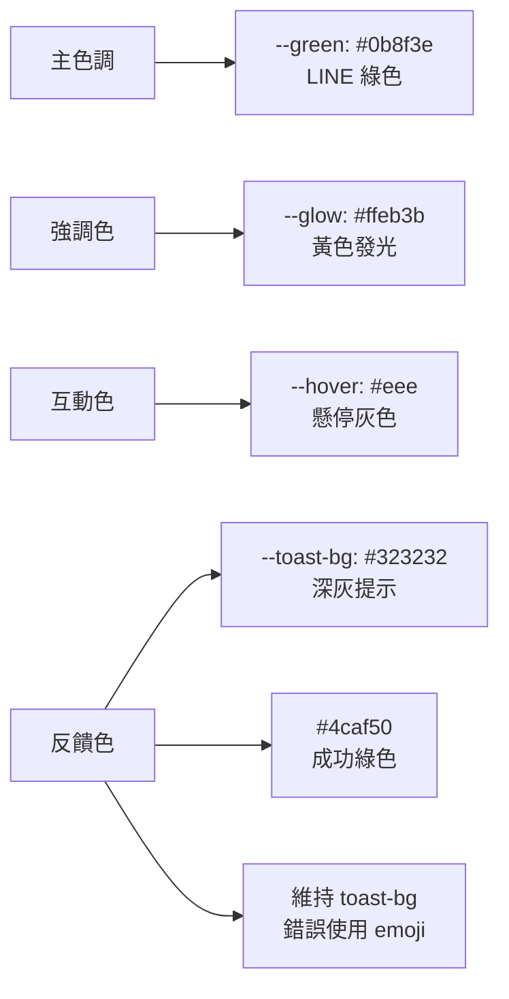

## 維護指南

### 新增畫面樣式步驟

1. 在 `script.js` 的 `SCREENS` 定義畫面結構
2. 在 `style.css` 添加對應的 `.畫面名稱` 類別
3. 確保在桌面和行動端都測試
4. 驗證無垂直捲軸（360×640 最小尺寸）

### 修改顏色主題

只需修改 CSS 變數：

```css
:root {
  --green: #你的顏色;
  --glow: #你的顏色;
}
```

### 調整行動端尺寸

在 `@media (max-width:600px)` 區塊中調整：

```css
@media (max-width:600px) {
  .topbar { min-height: 你的高度px; }
  .controls button { min-height: 你的高度px; }
  /* 確保總高度 ≤ 100dvh */
}
```

### 行動端除錯檢查清單

- [ ] body overflow: hidden
- [ ] body height: 100dvh
- [ ] topbar flex: 0 0 auto
- [ ] practice flex: 1, min-height: 0
- [ ] guide 內容緊湊
- [ ] controls 固定高度
- [ ] phone-wrap flex: 1
- [ ] 內部 .scroll overflow-y: auto
- [ ] 測試 360×640 最小尺寸

## 效能優化

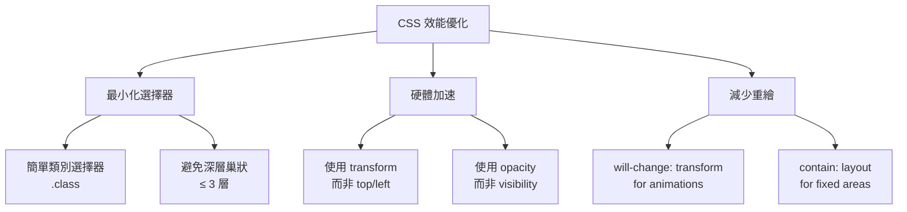

## 無障礙設計

雖然目標使用者是長輩，但仍保持基本無障礙：

- 大按鈕：最小 48×48px
- 高對比：深色文字配淺色背景
- 大字體：行動端 18-20px
- 清晰反饋：提示框、發光效果
- 語音支援：配合 `speak()` 功能

## 總結

style.css 的核心設計理念：

1. **行動端優先**：確保小螢幕完美顯示
2. **無捲軸保證**：100dvh flexbox 布局
3. **清晰視覺**：大按鈕、大字體、高對比
4. **即時反饋**：發光、提示框、動畫
5. **簡潔程式碼**：避免過度複雜的選擇器
